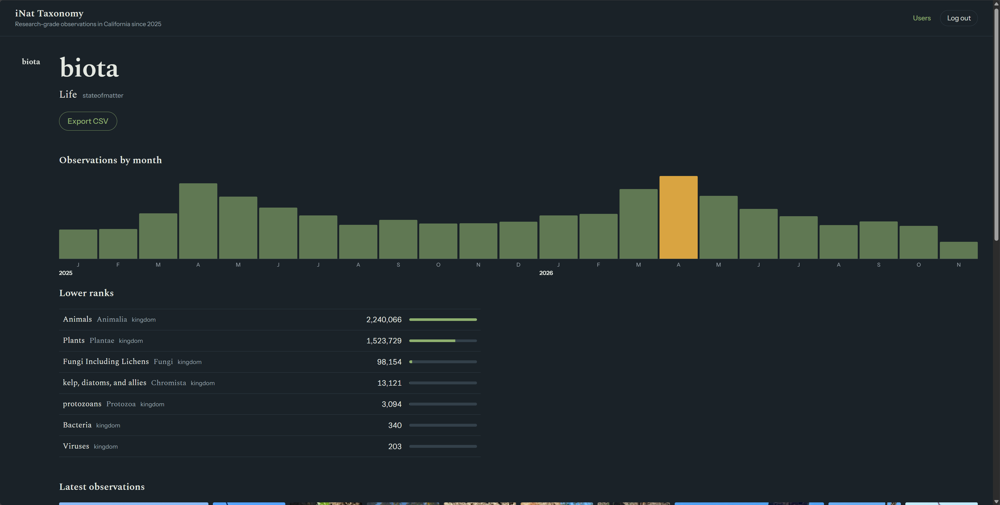
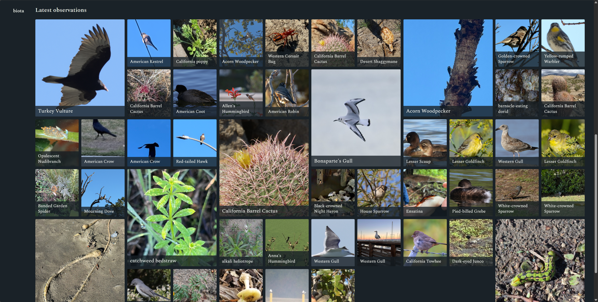
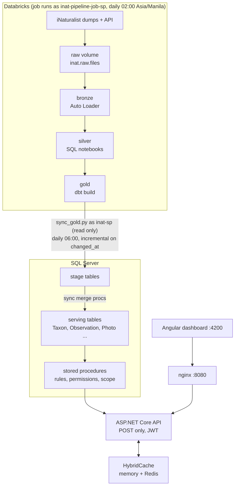
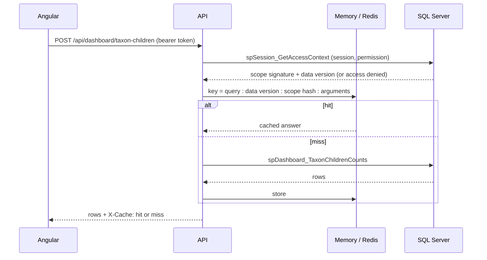

# inat-taxonomy-pipeline

End-to-end pipeline on iNaturalist data: a Databricks lakehouse builds the data every night, a Python sync copies it into SQL Server, and a C# API serves it to an Angular dashboard where you browse the tree of life with charts and a photo grid.

## Screenshots





## Architecture



## How a dashboard request works



Access is checked in the database on every request, even for cached answers, so logout and permission changes apply at once. A new sync changes the data version, so old cache entries are never asked for again.

## Design rules

- **Stored procedures are the source of truth** for business rules, permissions, scope, caps, statuses and messages. The API is a middle man and the UI stays dumb.
- **Every procedure checks a permission** through `security.spSession_CheckAccess`, with codes from the seeded `security.Permission` table, and returns only rows inside the session's taxon scope.
- **All endpoints are POST** (RPC style, request object in the body).
- **No `EXECUTE AS`:** procedures that need extra rights are signed with a certificate whose private key is removed after every publish.
- **Two service principals with separate jobs:** `inat-pipeline-job-sp` runs the Databricks job and owns the raw, bronze, silver and gold schemas (no secret). `inat-sp` is read-only on gold and is the only credential on the sync machine.

## Notable pieces

| Piece | What it does |
|---|---|
| Incremental sync | `sync\sync_gold.py`: Taxon, Photo, Observation and Observation_Photo load only rows changed since the watermark; Observer is always full; Sundays run a full extract. A watchdog stops a stalled fetch after 600 s. |
| `tools\run_sync.ps1` | Syncs only when the latest Databricks run succeeded and is newer than the last sync. Scheduled task "inat sync gold", daily 06:00. |
| Photo grid paging | `spTaxonomy_ObservationsPage`: cursor pagination. A fast path reads the newest observations from a date index and stops after one page; small taxa fall back to a subtree list. Animals went from about 4.5 s to about 0.1 s. |
| Cache warm-up | `CacheWarmer` logs in as `cache.warmer` and, after every new sync, warms the start page and every kingdom, so the first visitor after the sync gets cached answers. |
| Migrations | `database\Scripts\Migrations`: Pre scripts save data before a schema change, Post scripts run once each, recorded in `dbo.MigrationHistory`. See the [migrations README](database/Scripts/Migrations/README.md). |
| Background export | CSV exports run in a worker inside the API, claimed through `spExport_Claim` so two instances never take the same job. |

## Repository layout

| Folder | Contents |
|---|---|
| `notebooks`, `resources`, `databricks.yml` | Databricks job (bundle) and its notebooks |
| `dbt` | gold models, snapshot and tests |
| `sync` | Python sync from gold to SQL Server |
| `database` | SQL Server project (SDK-style sqlproj, dacpac) |
| `api` | ASP.NET Core API (.NET 10) and its tests |
| `web` | Angular dashboard |
| `tools` | run, test and setup scripts |

## Running locally

Prerequisites: SQL Server (default instance), .NET 10 SDK, SqlPackage, Node.js, Docker Desktop, Python with `requirements.txt`, Databricks CLI.

1. Publish the database:
   ```powershell
   dotnet build database\inat.sqlproj
   SqlPackage /Action:Publish /SourceFile:database\bin\Debug\inat.dacpac /TargetConnectionString:"Server=.;Database=inat;Integrated Security=true;TrustServerCertificate=true"
   ```
2. Create an administrator (asks for the password without showing it):
   ```powershell
   $env:AdminPasswordHash = dotnet run --project api\Inat.Api -- hash-password | Select-Object -Last 1
   sqlcmd -S . -E -C -N -b -I -i tools\sql\create_admin_user.sql -v AdminUsername=admin AdminFirstName=Admin AdminLastName=User AdminEmail=admin@example.com
   Remove-Item Env:AdminPasswordHash
   ```
3. Optional cache warm-up: set `CacheWarmer:Username`, `CacheWarmer:Password` and `CacheWarmer:RootTaxonId` with `dotnet user-secrets` in `api\Inat.Api`, then create the account with `tools\sql\create_cache_warmer.sql` (password hash in `CacheWarmerPasswordHash`, same pattern as step 2).
4. Start Redis and the load balancer: `docker compose up -d`
5. Start the API (port 5092): `dotnet run --project api\Inat.Api`
6. In a new terminal, start the dashboard (port 4200): `cd web; npm start`

Databricks:

```powershell
databricks bundle deploy -p <profile>
databricks bundle run inat_taxonomy_pipeline -p <profile>
```

## Tests

- `.\tools\run_tests.ps1`: SQL tests on fresh `inat_test_empty` and `inat_test_copy` databases, then the C# tests.
- `.\tools\run_ui_tests.ps1 -Headed`: Playwright tests in a visible browser (stop any running API first).
- CI (`.github\workflows\ci.yml`): API build and unit tests, dacpac build, Angular build. Integration, SQL and Playwright tests run locally only.

## Next steps

- Cache warm-up covers full-scope users only; users with a restricted taxon scope still fill their cache on first use.
- Warm-up stops at the kingdoms; deeper levels are cached on first visit.
- Run the SQL, integration and Playwright tests in CI (needs a SQL Server service container).
- Pre migrations have no history table, because it does not exist yet on a new database; each Pre script must check the schema itself.